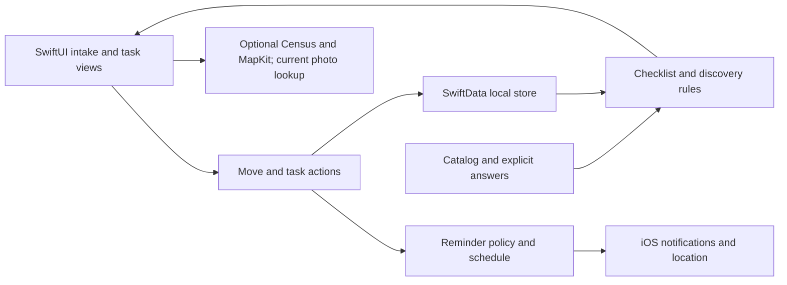

**MovingSoon: $4.99 paid-release review — October 20, 2026**

**Recommendation: the product can support a $4.99 one-time price, but I would hold the current build for a focused reliability and content pass.** It already offers a useful combination of personalized account discovery, explicit service choices, official/provider links, separate accounts and moving reminders. The immediate work is making those promises dependable. Price acceptance is a product judgment here; no customer willingness-to-pay study was performed.

Reviewed the current source at commit `7aff543`, release resources, existing store copy and one stored dashboard screenshot. Older review documents were background, not evidence that their findings remain unfixed. No application code was changed. This review does not establish live App Store Connect configuration or real-device behavior.

**Current use cases and their gaps**

| Customer situation | Current support | What is missing |
|---|---|---|
| Planning a future US/Canadian move | Date/postal intake, household interview, bank selection, personalized tasks | Correct regional mappings and a maintained content contract |
| Already moved and discovering missed accounts | Dashboard contains post-move tasks and a check-in | Onboarding only permits today or a future date |
| Remembering easily forgotten subscriptions/services | Search, grouped topics, persistent confirmed/not-applicable/unsure answers | Better task-specific steps; custom tasks cannot fully edit their original date/note/category |
| Several providers or household accounts | Independent task UUIDs, provider names, nicknames, shipment/renewal dates | Provider edits do not update location identity; no household delegation/sharing |
| Depending on reminders | Scheduled notifications, snooze/mute, optional proximity reminders | Resume/unmute, explicit consent renewal, understandable coverage limits |
| Moving across time zones | Calendar-based calculations | Date-only values are stored as instants and can change calendar day |
| Finishing this move and moving again later | Completion celebration and editable move | Archive/start-next/cancel workflow; only destructive Start Over exists |
| Keeping a record or recovering on another phone | Local SwiftData storage; unreadable stores are preserved | No in-app export/import, sync or usable store-recovery workflow; OS backup behavior was not tested |
| US/Canada cross-border move | Both geographic contexts can inform service review | Not a comprehensive immigration, tax, eligibility or jurisdiction-specific deadline system |

**Fix before taking payment: highest-impact findings**

1. **Regional mapping is materially wrong for several supported locations.**

   The exact production `ZipBucketService` function was executed in an isolated Swift script. Examples:

   | Input | Current result | Expected state/province |
   |---|---|---|
   | `19701`, `19901` | PA | DE |
   | `96701`, `96813` | CA | HI |
   | `99501`, `99901` | WA | AK |
   | `20101` | DC, with DC metro bucket | VA |
   | `20601`, `20901` | DC | MD |
   | `71601`, `71901` | LA | AR |
   | `83001`, `83101` | ID | WY |
   | `X0A0H0` | NT | NU |

   Broad contiguous ranges cause these errors. The resulting buckets affect bank filtering, static state comparisons and regional prompts; destination buckets are also persisted during intake/editing. Census ZIP requests use a separate path, so this does not establish that Census responses themselves are wrong. The separate `PostalCodeService` correctly distinguishes Nunavut, creating an internal inconsistency.

   **Action:** replace approximate ranges with an authoritative mapping, explicitly handle exceptions, and test all supported states/provinces and known boundary cases. Recompute affected persisted buckets when opening existing moves. See [ZipBucketService.swift](movingsoon.app/Services/ZipBucketService.swift), lines 33–103, and [CoreIntakeView.swift](movingsoon.app/Views/Onboarding/CoreIntakeView.swift), line 444. The [USPS prefix matrix](https://fast.usps.com/fast/fastApp/resources/labelListFileDetails.action?effectiveDateStr=04%2F01%2F2025&listCode=L002) corroborates the Delaware and Hawaii examples.

2. **The photo request contradicts the privacy policy and lacks API attribution.**

   `UnsplashService` uses `cityBucket ?? zip` as its outgoing search term. Every Canadian postal code currently has no city bucket, as do many US ZIPs. Dashboard loading calls this automatically. The policy explicitly says ZIP codes are not sent to Unsplash. The response model retains no photographer/profile attribution, and the dashboard renders the photo without a credit.

   **Action:** use a bundled background or a generic non-location query when no city bucket exists; align disclosures with the actual request. If retaining the API, preserve and display photographer/Unsplash credit with the required links, and verify production API access. Bundled imagery is already available.

   Evidence: [UnsplashService.swift](movingsoon.app/Services/UnsplashService.swift), lines 31–49; [ZenDashboardView.swift](movingsoon.app/Views/Dashboard/ZenDashboardView.swift), lines 690 and 899; [UnsplashPhoto.swift](movingsoon.app/Models/UnsplashPhoto.swift); [PRIVACY_POLICY.md](PRIVACY_POLICY.md), line 39. [Unsplash’s API attribution requirements](https://help.unsplash.com/en/articles/2511315-guideline-attribution) expressly require photographer/Unsplash credit and profile links. An empty collection declaration in the privacy manifest alone does not settle App Store privacy-label answers; those depend on actual third-party practices and [Apple’s collection definition](https://developer.apple.com/app-store/app-privacy-details/).

3. **Calendar dates can move backward a day during a move.**

   Shipment/renewal/custom dates are normalized to local midnight, saved as `Date`, and later interpreted in the phone’s current time zone. Reproduction: November 2, 2026 at midnight in New York becomes November 1 at 9 p.m. in Los Angeles. The current three-day lead calculation changes October 30 to October 29. Moving day also needs a deliberate time-zone policy.

   **Action:** represent calendar dates as year/month/day with explicit calendar/time-zone semantics, and use one conversion path for display, ordering and notification construction. Cover east/west travel and daylight-saving boundaries. See [ServiceAccountService.swift](movingsoon.app/Services/ServiceAccountService.swift), lines 85–86; [ChecklistTask.swift](movingsoon.app/Models/ChecklistTask.swift), lines 110–122; [ServiceAccountsView.swift](movingsoon.app/Views/Settings/ServiceAccountsView.swift), lines 50–54; [MoveChecklistService.swift](movingsoon.app/Services/MoveChecklistService.swift), line 137.

4. **The paid content needs a focused accuracy and actionability audit.**

   Government items use generic timing offsets and often link to a homepage. Driver/vehicle tasks point to `dmv.org`, rather than a destination-state change-address procedure. A US passport address update is always included, although the [State Department says an address change after receipt of the passport does not require contacting it](https://travel.state.gov/en/passports/contact-support/faq.html). Eligibility-dependent services should be confirmed rather than assumed from residence alone.

   **Action:** audit the most important 30–50 tasks first. Each should state who needs it, the exact action, the official destination, what to prepare, whether timing is a suggested target or an official deadline, and when its guidance was last checked. Broader jurisdiction coverage can follow an explicitly limited launch scope. See [ItemCatalog.swift](movingsoon.app/Services/ItemCatalog.swift), lines 88–134, and [CatalogItem.swift](movingsoon.app/Services/CatalogItem.swift), lines 4–35. Current topic-level tips are useful but do not provide that content contract.

5. **Store copy and stored screenshots promise a different experience.**

   The listing claims automatic LA Fitness/Xcel coverage knowledge; the actual implementation offers customer-triggered MapKit leads, not a provider serviceability/transfer database. It claims an in-app USPS scam warning that is absent from the current UI, quotes an outdated $1.10 fee, and describes one-tap notification completion although notification actions are Update Now/Snooze/Mute. [USPS currently lists a $1.25 online identity-verification fee](https://www.usps.com/manage/forward.htm).

   The inspected `01_dashboard_tiles.png` also shows “30% lower cost of living,” while current code correctly describes state home values instead. Regenerate screenshots from the release candidate and rewrite the listing around supported behavior. [Apple requires accurate metadata and screenshots](https://developer.apple.com/app-store/review/guidelines/), particularly section 2.3. Evidence: [APP_STORE_LISTING.md](APP_STORE_LISTING.md), lines 39–45; [ProviderAvailabilityService.swift](movingsoon.app/Services/ProviderAvailabilityService.swift), lines 14–45; [SmartReminderService.swift](movingsoon.app/Services/SmartReminderService.swift), lines 50–56.

6. **Persistence success and upgrade compatibility need stronger release evidence.**

   Most mutations use `saveOrLog`, which catches failures while the UI continues. Intake advances, completion shows success and reminders can be rebuilt even when saving failed. The new account editor handles this better with a throwing save and targeted rollback; extend that pattern to important actions. Preserve edits and show retryable feedback.

   The latest account/date schema has no exercised existing-store upgrade test. Automatic lightweight migration may be entirely appropriate for additive optional properties; absence of a custom migration plan is not itself a defect. The gap is proof that real saved tasks, notes, decisions and account dates survive upgrade/relaunch. The current recovery screen preserves files but offers no in-app recovery/export procedure. See [ModelContext+SafeSave.swift](movingsoon.app/Services/ModelContext+SafeSave.swift), line 11; [CoreIntakeView.swift](movingsoon.app/Views/Onboarding/CoreIntakeView.swift), line 459; [ZenDashboardView.swift](movingsoon.app/Views/Dashboard/ZenDashboardView.swift), line 941; [ServiceAccountService.swift](movingsoon.app/Services/ServiceAccountService.swift), lines 95–115; [movingsoon_appApp.swift](movingsoon.app/movingsoon_appApp.swift), line 60.

**Complete the core customer flows**

| Priority | Gap and evidence | Concrete completion criterion |
|---|---|---|
| Before launch | Muting is one-way. Eligibility excludes muted tasks; no UI clears mute. [ReminderPolicy.swift](movingsoon.app/Services/ReminderPolicy.swift):15; [ServiceAccountsView.swift](movingsoon.app/Views/Settings/ServiceAccountsView.swift):27 | Task details expose Resume reminders and clear snooze, and refresh schedules. Reopening a completed task makes its reminder state explicit. |
| Before launch | “I already moved” cannot enter the correct date. [CoreIntakeView.swift](movingsoon.app/Views/Onboarding/CoreIntakeView.swift):143 | Accept recent past dates and generate a usable catch-up checklist. |
| Before launch if location remains a headline feature | Consent can expire before moving day and has no renewal path. [ReminderPolicy.swift](movingsoon.app/Services/ReminderPolicy.swift):19 | Show start/expiry and provide an explicit, customer-initiated renewal. Do not renew silently. Provide notification Settings recovery independently of location consent. |
| Before launch | Account provider edits change the title but location matching still uses old institution/catalog metadata. [ServiceAccountService.swift](movingsoon.app/Services/ServiceAccountService.swift):80; [LocationPlaceTarget.swift](movingsoon.app/Services/LocationPlaceTarget.swift):26 | Either constrain a brand account to that brand or reconcile provider identity and location targeting when edited. A renamed Planet Fitness account must not silently keep matching Planet Fitness. |
| Before launch | Custom task editor does not edit the original custom deadline, category or note. [CustomTaskView.swift](movingsoon.app/Views/Settings/CustomTaskView.swift); [ServiceAccountsView.swift](movingsoon.app/Views/Settings/ServiceAccountsView.swift):87 | User can correct all fields entered at creation and see reminders change accordingly. |
| Before launch | Large text is capped at accessibility1 in dashboard/list; intake uses fixed fonts; financial selection lacks a selected accessibility trait. [ZenDashboardView.swift](movingsoon.app/Views/Dashboard/ZenDashboardView.swift):712; [DashboardView.swift](movingsoon.app/Views/Dashboard/DashboardView.swift):209; [FinancialScreenView.swift](movingsoon.app/Views/LifestyleInterview/FinancialScreenView.swift):90 | Walk through at maximum text sizes and VoiceOver on a small screen; selected choices and critical instructions remain clear. |
| Near-term | No archive/start-next/cancel move workflow. Settings only deletes tasks/profile to restart. [ContentView.swift](movingsoon.app/ContentView.swift):12; [EditMoveView.swift](movingsoon.app/Views/Settings/EditMoveView.swift):561 | Preserve the old move, stop its reminders and start a fresh move. |
| Near-term | No household sharing/export or app-level portability; `assignee` is explicitly parked. [ChecklistTask.swift](movingsoon.app/Models/ChecklistTask.swift):16 | Start with shareable checklist text or a printable completion record; assess live collaboration separately. |

Two smaller reliability issues deserve follow-up. Origin geocoding applies asynchronous results without checking that the ZIP is still current ([CoreIntakeView.swift](movingsoon.app/Views/Onboarding/CoreIntakeView.swift):110); use cancellation/input checks like the destination flow. Reminder coverage is silently bounded: visits search only the first 20 task requests, identical-provider accounts consume separate region slots, and schedules retain the earliest 60 requests ([GeofenceCoordinator.swift](movingsoon.app/Services/GeofenceCoordinator.swift):65,106; [ReminderScheduleBuilder.swift](movingsoon.app/Services/ReminderScheduleBuilder.swift):117). Group provider locations, make visit recognition policy independent of region-slot allocation, and define how later reminders remain covered when the customer does not reopen the app.

**Architecture assessment**

SwiftUI + SwiftData + deterministic local rules is a good fit for this price and problem. Stable catalog IDs, canonical aliases, separate explicit answers, pure reminder-policy/schedule functions and injected notification/location adapters are sound foundations. Offline checklist operation and no required account lower friction and ongoing costs.

The important boundaries are:

Four changes would improve maintainability without a rewrite:

1. Move task mutations and successful-save/reminder reconciliation into a small action service shared by views and notification actions. `ZenDashboardView.swift` is 2,659 lines and currently owns rendering, network loading, mutations and orchestration.
2. Establish one date-only abstraction and one provider-identity policy. Current task title, original catalog identity, institution name and edited provider name can disagree.
3. Add a catalog maintenance process: source/last-reviewed metadata, official-link checks, regional exception fixtures and concise task instructions. Keep the current declarative format if it remains convenient.
4. Make release checks reproducible: clean-checkout resource provisioning, CI, migration fixtures and a few complete customer-flow smoke tests. The ignored local Census key resource is packaged in Release today, so another build machine needs explicit provisioning. A bundled key is extractable and should not be treated as a server secret.

An app backend, an LLM, account integrations or income-based membership prediction are not prerequisites for this product. Current income rules are empty; the study infrastructure does not demonstrate customer value. Prioritize finishing address updates reliably. Area estimates can remain a secondary optional feature.

**Verification and launch gate**

Fresh verification for this review:

- Swift suite passed: 240 test definitions, 250 executions including parameterized cases, zero failures/skips, iPhone 17 / iOS 26.0. Result: `/tmp/movingsoon-review-tests.xcresult`; log: `/tmp/movingsoon-review-test.log`.
- Python evaluator suite: 10 tests passed.
- Unsigned Release iPhone build succeeded: `/tmp/movingsoon-review-release.log`. No Swift compiler diagnostics; only an AppIntents metadata-extraction warning.
- Release includes privacy manifest, pilot JSON and the locally ignored Census key resource. Icon is 1024×1024 without alpha. Display name is not explicitly configured; bundle name remains `movingsoon.app`.
- Exact-source regional mapping and Foundation time-zone reproductions confirmed the findings above. No fixes were applied.

Passing tests do not cover the latest account/date workflows directly. The test target requires iOS 26 although the app supports iOS 17; minimum-version behavior was not verified. No signed archive/upload validation, interactive UI walkthrough, existing-store migration, permission/background delivery, accessibility or network-failure acceptance was performed. Current [Apple submission requirements](https://developer.apple.com/news/upcoming-requirements/?id=02032026a) require Xcode 26/iOS 26 SDK or later; installed Xcode 26 satisfies that build-tool minimum.

Before release, exercise one complete move on a real phone, one upgrade with saved progress, one cross-time-zone scenario, one late-start move, multiple account dates, mute/resume, denied permissions and offline/failed optional requests. Verify support and privacy URLs without authentication; public availability could not be established by the web fetch in this review. Add a normal in-app support contact. Finish App Store Connect price, paid-app agreements, tax/banking, privacy answers, territory scope, age-rating answers and release screenshots; these account-side settings were not inspected. Set the actual $4.99 price in App Store Connect rather than relying on the listing’s old “Tier 5” label, following [Apple’s pricing workflow](https://developer.apple.com/help/app-store-connect/manage-app-pricing/set-a-price/).

For customer validation, give the release candidate to 5–10 people who recently moved or are actively moving. Watch whether they find an overlooked account, understand what action to take, and complete it without help. Ask about $4.99 after they have used the workflow. This tests the paid value proposition more directly than expanding the catalog count.

Suggested positioning: **“Your personalized address-change checklist. Remember the accounts, follow the steps, and finish your move. $4.99 once.”** Make clear that the customer completes updates with providers and enters shipment/renewal dates manually. The paid promise should be supported by accurate guidance, dependable reminders and recoverable progress.
